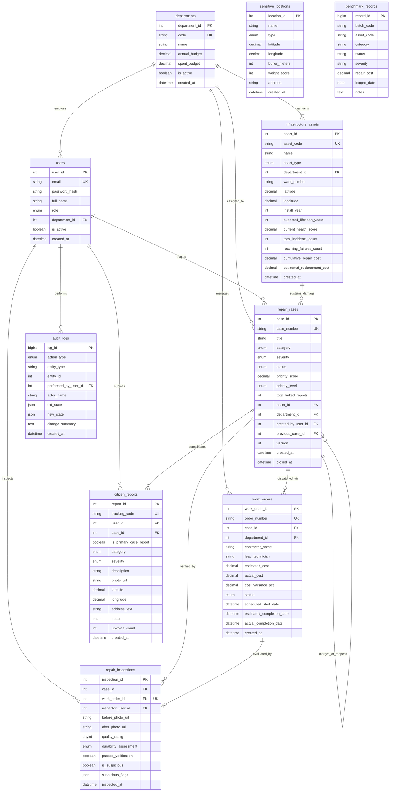

# Entity-Relationship (ER) Diagram & Structural Analysis

## 1. System Overview

**CivicFix** is an enterprise-grade municipal infrastructure monitoring and repair intelligence system. The database is designed according to relational database design principles and modeled to represent real-world civic entities, physical infrastructure assets, citizen submissions, work order dispatches, quality inspections, and immutable audit logs.

---

## 2. Entity Dictionary

The system consists of **10 strongly-typed entities** in Third Normal Form (3NF):

| Entity Name | Description | Key Business Function |
| :--- | :--- | :--- |
| **`departments`** | Municipal departments (e.g., Roads & Bridges, Water Supply) | Manages public budgets, personnel, and assigned physical assets |
| **`users`** | Actors within the system (CITIZEN, STAFF, ADMIN) | Role-Based Access Control (RBAC), authentication, and ownership |
| **`sensitive_locations`** | Vulnerable urban coordinates (Hospitals, Schools, Transit Hubs) | Spatial safety buffers and risk score prioritization |
| **`infrastructure_assets`** | Physical infrastructure memory (Road segments, Bridges, Drains) | Asset health index, lifespan tracking, and recurrence tracking |
| **`repair_cases`** | Consolidated repair cases grouping one or more citizen reports | Core lifecycle management, risk prioritization score, state transitions |
| **`citizen_reports`** | Granular citizen problem reports with photos and tracking codes | Crowdsourced defect intake, GPS coordinates, upvotes |
| **`work_orders`** | Field execution orders dispatched to contractors or municipal crews | Cost estimations, actual costs, scheduled deadlines, work status |
| **`repair_inspections`** | Post-repair quality and verification audits | Before/after photographic audits, quality ratings, anomaly flags |
| **`audit_logs`** | Append-only immutable system event log | Historical change tracking, security auditing, JSON state diffs |
| **`benchmark_records`** | 12,000+ synthetic benchmarking dataset | Live `EXPLAIN` query optimization demonstration |

---

## 3. Mermaid Entity-Relationship (ER) Diagram

---

## 4. Cardinality & Participation Matrix

In relational modeling, cardinality defines the numerical relationship between entities ($1:1$, $1:N$, $M:N$), while participation defines whether an entity's existence requires association with another entity (**Total / Mandatory** vs. **Partial / Optional**).

| Relationship | Cardinality | Parent Entity Participation | Child Entity Participation | Foreign Key & Constraint Implementation |
| :--- | :---: | :---: | :---: | :--- |
| `departments` $\to$ `users` | $1:N$ | Partial (Dept may have 0 users initially) | Partial (`CITIZEN` has `NULL` department; `STAFF`/`ADMIN` have FK) | `users.department_id` REFERENCES `departments.department_id` (`ON DELETE SET NULL`) |
| `departments` $\to$ `infrastructure_assets` | $1:N$ | Partial | **Total (Mandatory)**: Every asset must belong to a responsible department | `infrastructure_assets.department_id` REFERENCES `departments.department_id` (`ON DELETE RESTRICT`) |
| `departments` $\to$ `repair_cases` | $1:N$ | Partial | **Total (Mandatory)**: Every case is assigned to a department | `repair_cases.department_id` REFERENCES `departments.department_id` (`ON DELETE RESTRICT`) |
| `departments` $\to$ `work_orders` | $1:N$ | Partial | **Total (Mandatory)**: Every work order is managed by a department | `work_orders.department_id` REFERENCES `departments.department_id` (`ON DELETE RESTRICT`) |
| `users` $\to$ `citizen_reports` | $1:N$ | Partial | **Total (Mandatory)**: Every report must have an authenticated submitter | `citizen_reports.user_id` REFERENCES `users.user_id` (`ON DELETE RESTRICT`) |
| `users` $\to$ `repair_inspections` | $1:N$ | Partial | **Total (Mandatory)**: An inspector must sign off on every inspection | `repair_inspections.inspector_user_id` REFERENCES `users.user_id` (`ON DELETE RESTRICT`) |
| `users` $\to$ `audit_logs` | $1:N$ | Partial | Partial: Direct SQL or trigger events may have `performed_by_user_id = NULL` | `audit_logs.performed_by_user_id` REFERENCES `users.user_id` (`ON DELETE SET NULL`) |
| `infrastructure_assets` $\to$ `repair_cases` | $1:N$ | Partial | **Total (Mandatory)**: Every case must map to a physical asset | `repair_cases.asset_id` REFERENCES `infrastructure_assets.asset_id` (`ON DELETE RESTRICT`) |
| `repair_cases` $\to$ `citizen_reports` | $1:N$ | **Total (Mandatory)**: A case must have $\ge 1$ report | **Total (Mandatory)**: Every report belongs to a case | `citizen_reports.case_id` REFERENCES `repair_cases.case_id` (`ON DELETE RESTRICT`) |
| `repair_cases` $\to$ `work_orders` | $1:N$ | Partial (Case in `OPEN` state has 0 work orders) | **Total (Mandatory)**: Work order must target an existing case | `work_orders.case_id` REFERENCES `repair_cases.case_id` (`ON DELETE RESTRICT`) |
| `work_orders` $\to$ `repair_inspections` | $1:1$ | Partial (Inspection only exists after repair) | **Total (Mandatory)**: Inspection must evaluate a completed work order | `repair_inspections.work_order_id` REFERENCES `work_orders.work_order_id` (`ON DELETE RESTRICT`, `UNIQUE`) |
| `repair_cases` $\to$ `repair_cases` (Self) | $1:N$ | Partial (Recursive) | Partial: Tracks recurrence history or merge targets | `repair_cases.previous_case_id` REFERENCES `repair_cases.case_id` (`ON DELETE SET NULL`) |

---

## 5. Elimination of $M:N$ Relationships

Relational database theory mandates that Many-to-Many ($M:N$) relationships must be resolved into associative entities to eliminate update and deletion anomalies:

1. **Citizen Submissions $\longleftrightarrow$ Physical Assets ($M:N$ resolved):**
   - Citizens lodge reports against urban locations, while assets experience multiple incidents over their lifespan.
   - **Resolved via Associative Entity**: `repair_cases` acts as the unifying entity. Individual submissions are grouped into `citizen_reports` referencing `repair_cases`, which in turn references `infrastructure_assets`.
2. **Work Orders $\longleftrightarrow$ Inspections ($1:1$ strictly enforced):**
   - Each work order receives at most one formal post-repair inspection audit.
   - Enforced by placing a `UNIQUE` constraint on `repair_inspections.work_order_id`.
